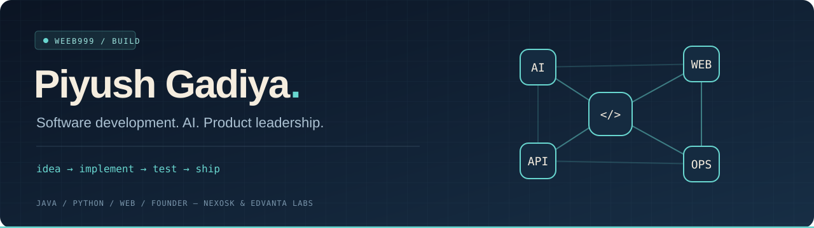

<p align="center"></p>

<p align="center">
<a href="https://www.linkedin.com/in/piyush-gadiya-a42225228"></a>
<a href="mailto:piyushgadiya123@gmail.com"></a>
<a href="https://clipforge-the-next-step.netlify.app/"></a>
</p>

### Engineering ideas into working systems.

I'm **Piyush Gadiya**, an **AI Systems Engineer at PHN Technology, Pune**. I build across machine learning, LLM applications, backend services, and automation—with an interest in how those pieces work together as usable products.

My projects span browser-based video editing, document generation, event-driven monitoring, and full-stack applications. I enjoy taking an idea through implementation, testing, and deployment.

```text
focus     →  AI systems · LLM applications · developer tooling
build     →  Python services · web interfaces · automation workflows
operate   →  containers · CI/CD · metrics and observability
```

### Selected work

| Project | What it does | Core technologies |
| :--- | :--- | :--- |
| **[Clipforge](https://github.com/weeb999/Clipforge)** · [Live demo ↗](https://clipforge-the-next-step.netlify.app/) | Turns local videos into captioned short clips. Includes a responsive browser editor and a Python CLI, with English captions and Arabic-to-English translation. | Python · JavaScript · Whisper · FFmpeg |
| **[Notes Generation Agent](https://github.com/weeb999/Notes-LLM-Model)** | Generates structured AI, ML, and deep-learning study notes with browser previews and printable PDF exports. | Python · Gemini · Streamlit |
| **[Monitoring & Alert System](https://github.com/weeb999/Alert-Monitoring-)** | A runnable reference architecture for log ingestion, statistical anomaly detection, dashboards, and automated alerts. | Python · Kafka · Prometheus · Grafana · n8n |
| **[DelphiLabs](https://github.com/weeb999/DelphiLabs)** | A platform MVP for institutions to discover and book workshops, training, and internships, with authentication and payments. | Next.js · Tailwind CSS · Supabase · Razorpay |

### Technical toolkit

| Area | Technologies I work with |
| :--- | :--- |
| **Languages** | Python, JavaScript, Java, SQL |
| **Machine learning & vision** | PyTorch, TensorFlow, scikit-learn, Hugging Face, OpenCV, YOLO |
| **LLM applications & NLP** | LLM APIs, retrieval-augmented generation, prompt engineering, spaCy |
| **Application development** | FastAPI, Flask, React, Streamlit, Next.js |
| **Data & messaging** | PostgreSQL, MySQL, MongoDB, Kafka |
| **Delivery & operations** | AWS, Docker, Kubernetes, Jenkins, GitHub Actions, Prometheus, Grafana |

### Research & foundations

- **[Skin Cancer Prediction](https://github.com/weeb999/Skin-Cancer-Prediction)** — machine-learning exploration of skin cancer detection and classification.
- **[Banking System](https://github.com/weeb999/BankingSystem)** — Java application built around object-oriented programming and JDBC database integration.
- **Certifications:** IBM DevOps · HackerRank Java · Jenkins Automator · Udemy Java Master.

### Let's build something useful.

Interested in AI applications, automation, or developer tools? Connect on [LinkedIn](https://www.linkedin.com/in/piyush-gadiya-a42225228) or reach me at **[piyushgadiya123@gmail.com](mailto:piyushgadiya123@gmail.com)**.

<p align="center"><sub>Explore the repositories for implementation details, setup guides, and current limitations.</sub></p>
